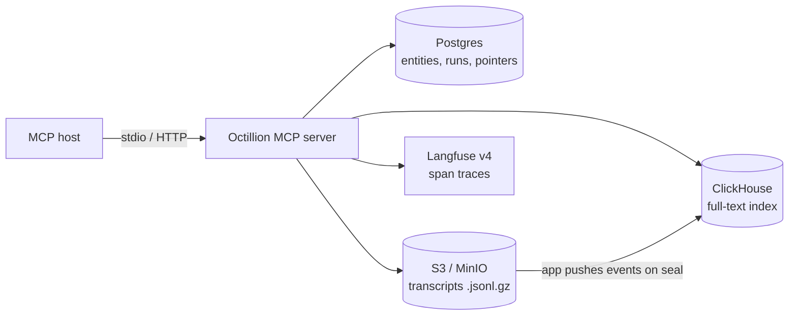
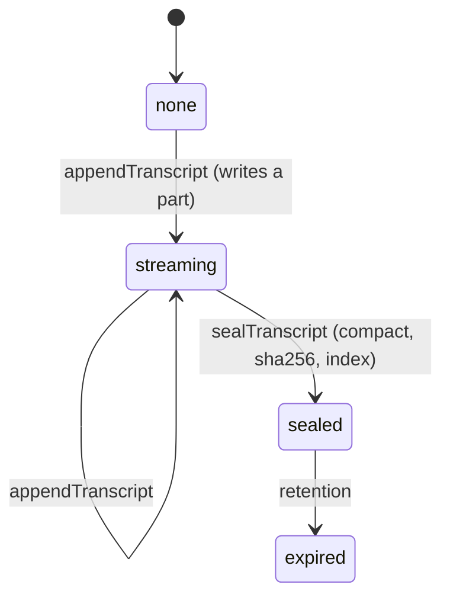

# Octillion

A Postgres-backed **MCP server** with an interactive **MCP-UI dashboard**. It gives AI assistants read-only access to DevTools product, customer and agent-observability data. One command brings it up, every tool is covered by an end-to-end test, and each kind of data lives in the store best suited to it.

| Context | Source of truth | Tools |
|---|---|---|
| Product description | Postgres `products` | `get_product_overview` |
| User accounts | Postgres `user_accounts` | `get_user_account` |
| Developer population | Postgres `developer_segments` | `get_developer_population` |
| Trace runs history | Postgres (summaries), S3 (transcripts), ClickHouse (search), Langfuse (spans) | `list_trace_runs`, `get_agent_session`, `get_session_transcript`, `search_transcripts`, `get_run_trace` |

Every tool returns a text summary for the model and `structuredContent` for a dashboard, which the host renders inline (`ui://devtools/dashboard.html`, MCP Apps).

---

## Quick start

**Zero-config (no Docker).** This mode uses embedded PGlite and on-disk transcripts. Search and Langfuse are off.

```bash
npm install
npm run smoke         # end-to-end test via a real MCP client
npm run start:http    # MCP: http://127.0.0.1:3333/mcp, dashboard: http://127.0.0.1:3333/preview
```

**Full stack.** Adds Postgres, MinIO, ClickHouse and Langfuse.

```bash
cp .env.example .env
npm run setup:local   # compose up, then seed Postgres, transcripts, the search index and Langfuse
npm run smoke
npm start             # stdio server
```

**Connect a host** (Claude, VS Code, Goose, MCPJam, ...):

```json
{ "mcpServers": { "octillion": { "command": "npx",
  "args": ["tsx", "--env-file-if-exists=/abs/path/.env", "/abs/path/src/stdio.ts"] } } }
```

Don't use `npm start` as the host command, because npm's banner corrupts the stdio stream.

Requirements: Node 20.20+ (22 recommended), and Docker with about 8 GB of memory for the full stack.

---

## Architecture



**One home per byte.** Each kind of data lives in exactly one place:
- Postgres holds what you filter and aggregate.
- Object storage holds raw transcripts.
- ClickHouse holds the search index.
- Langfuse holds spans.

The stores are joined by stable IDs:

| ID | Postgres | Object storage | ClickHouse | Langfuse |
|---|---|---|---|---|
| `ses_…` | `agent_sessions.id` | file name | `session_id` | session ID |
| `run_…` | `trace_runs.id` | `run_id` on events | `run_id` | trace metadata |
| `langfuse_trace_id` | `trace_runs` | on events | yes | trace ID |

---

## Trace data path

### Transcripts: pointer in SQL, bytes in the bucket



- **Append:** each append writes a gzipped JSONL part, plus a row in `session_transcript_parts`.
- **Seal:**
  1. Merge the parts and drop duplicate `seq` values left by retried writes.
  2. Write the final object.
  3. Record `transcript_key`, line count, bytes, `sha256` and `sealed_at` on `agent_sessions`, and delete the parts in the same transaction.
  4. Index the events into ClickHouse.
- **Read:** pages through events. It verifies the sha256 on sealed transcripts, reads live parts for streaming ones, and returns a 15-minute presigned download URL.
- **Crash safety:** the object is always written before the database row, so a crash can leave an orphaned object but never a row pointing at nothing.

Event lines look like `{"seq":3,"ts":"…","type":"tool_call","run_id":"run_00904","langfuse_trace_id":"…","name":"ocr_document","input":{…}}`. The event types are `session_start`, `user_message`, `tool_call`, `tool_result`, `assistant_message`, `run_end` and `session_end`.

### Bucket layout (Hive-style partitions)

```
transcripts/
  sessions/account_id=<id>/date=<yyyy-mm-dd>/env=<env>/agent=<agent>/<session>.jsonl.gz   sealed
  parts/account_id=…/date=…/env=…/agent=…/<session>/part-00001.jsonl.gz                   live
```

- **Account prefix:** per-tenant retention and deletion.
- **Date folders:** age-based lifecycle rules, matched by monthly ClickHouse partitions.
- **Scoped reindexing:** only lists the folders in scope.
- **Separate prefixes:** `sessions/` only ever holds complete transcripts.

### Full-text search (ClickHouse)

The `devtools.transcript_events` table has one row per event.

- **Partitioning and sort order:** `PARTITION BY toYYYYMM(date)`, `ORDER BY (account_id, date, session_id, seq)`.
- **Index:** `INDEX text_idx text_lc TYPE text(tokenizer = splitByNonAlpha)`, built over `lower(text)`, so search is case-insensitive.
- **What gets indexed:** message content, tool names, tool input/output JSON and errors.
- **Search modes:**
  - `all` uses `hasAllTokens`.
  - `any` uses `hasAnyTokens`.
  - `phrase` narrows candidates with the index, then requires an exact case-insensitive match.
- **Filters:** account, agent, env, event type, session and age.
- **Indexing:** pushed by the app at seal time, so it works with ClickHouse Cloud and a private bucket. `transcript_indexed_at` records when each transcript was indexed, and `npm run search:reindex` rebuilds the index:

  | Scope | ClickHouse is cleared with | Bucket listing |
  |---|---|---|
  | (none) | `TRUNCATE` | `sessions/` |
  | `--month 2026-10` | `DROP PARTITION 202610` | `sessions/`, filtered by date |
  | `--account 1 [--month …]` | lightweight `DELETE` | `sessions/account_id=1/[date=2026-10-]` |

- **Live sessions:** they become searchable once sealed.

### Span traces (Langfuse v4)

- **Write:** OTLP/HTTP JSON to `/api/public/otel/v1/traces`. Each run produces an agent root span, a `plan` generation, a tool or retriever span, and a `compose_answer` generation, with model, token usage and error level.
- **Read:** `/api/public/v2/observations?traceId=…`. Langfuse v4 runs in events-only mode, which disables the legacy `/traces` API.
- **Re-seeding:** v4 keys events by start time as well as ID, so `langfuse:seed` deletes existing traces and waits for that to finish before sending new ones. This takes about 2 minutes.

---

## MCP tools

All tools are read-only (`readOnlyHint`). `get_run_trace` is also `openWorldHint`, because it calls Langfuse.

| Tool | Inputs | Returns |
|---|---|---|
| `get_product_overview` | `slug?` | Product, features, pricing tiers, integrations, headline stats |
| `get_user_account` | `email?` (omit to list all) | Profile, quota usage, 30-day stats, workflows, recent sessions |
| `get_developer_population` | `dimension?` | Breakdown by role, language, region, experience or company size, with 30-day active counts |
| `list_trace_runs` | `email? session_id? status? environment? workflow? days?=14 limit?=25` | KPIs (failure rate, p50/p95, spend), daily status chart, runs |
| `get_agent_session` | `session_id` | Totals, run timeline, transcript pointer, Langfuse links |
| `get_session_transcript` | `session_id offset?=0 limit?=50` | Paged events (sealed or live), sha256, download URL |
| `search_transcripts` | `query? mode? email? agent? environment? type? session_id? days? limit?=25` | Hits, agent and event-type counts, read stats. With no query: index stats and bucket folders |
| `get_run_trace` | `run_id` | Span tree from Langfuse, rendered as a waterfall |

The dashboard covers Product, Accounts, Developers, Trace runs, Session, Transcript, Span waterfall and Search. The widget calls tools itself to drill down, adapts to light and dark themes, and pairs every status color with an icon and a label. You can preview any view without a host at `/preview/<tool>?<args>`.

---

## Configuration

| Variable | Default | Purpose |
|---|---|---|
| `DATABASE_URL` | unset, so PGlite in `.pglite/` (or `PGLITE_DIR`) | Postgres connection |
| `TRANSCRIPTS_S3_BUCKET` | unset, so local disk in `.transcripts/` (or `TRANSCRIPTS_DIR`) | Transcript bucket |
| `TRANSCRIPTS_S3_ENDPOINT`, `_REGION`, `_ACCESS_KEY_ID`, `_SECRET_ACCESS_KEY` | AWS defaults | S3, MinIO, R2 or GCS settings. Setting an endpoint enables path-style addressing |
| `CLICKHOUSE_URL` | unset, so search is off | ClickHouse HTTP(S) endpoint |
| `CLICKHOUSE_USER`, `CLICKHOUSE_PASSWORD` | `default`, empty | ClickHouse credentials |
| `CLICKHOUSE_CREDENTIALS_FILE` | unset | A gitignored file with `Username:`/`Password:` (and optionally `Host:`) lines. Takes priority over the variables above |
| `LANGFUSE_HOST`, `LANGFUSE_PROJECT_ID` | cloud.langfuse.com, unset | Deep links |
| `LANGFUSE_PUBLIC_KEY`, `LANGFUSE_SECRET_KEY` | unset, so `get_run_trace` is off | Langfuse API |
| `PORT`, `HOST` | `3333`, `127.0.0.1` | HTTP transport |

## Local stack

`docker-compose.yml` is based on Langfuse's official v4 compose file. It shares one Postgres (databases `devtools` and `langfuse`) and one MinIO (buckets `langfuse` and `transcripts`).

| Service | Address | Credentials |
|---|---|---|
| Langfuse | `localhost:3000` | `admin@devtools.local` / `devtools-admin`, project `devtools` |
| Postgres 17 | `localhost:5432` | `postgres` / `postgres` |
| MinIO | `localhost:9090` (API), `9091` (console) | `minio` / `miniosecret` |
| ClickHouse 25.12 | `localhost:8123` | `devtools` / `devtools` (scoped to the `devtools` database) |

- **Network exposure:** Redis, ClickHouse's native port and the Langfuse worker are only reachable inside the compose network, and every published port binds to `127.0.0.1`.
- **No variable substitution:** compose values are literals, so this project's `.env` can't leak into the Langfuse containers.
- **Credentials:** every credential in the stack is a local-only default.

## Commands

| Command | Does |
|---|---|
| `npm run setup:local` | `stack:up`, then `db:reset`, then `langfuse:seed` |
| `npm run db:reset` | **Destructive.** Recreates the schema and reseeds Postgres, transcripts and the search index |
| `npm run langfuse:seed` | Replaces the seeded traces in Langfuse. Run it after every `db:reset` |
| `npm run search:reindex -- [--account N] [--month YYYY-MM]` | Rebuilds the search index for that scope |
| `npm run smoke` | End-to-end test of every tool, the UI resource, transcript append, seal and dedupe, search and Langfuse. Re-runnable; parts for unconfigured services are skipped |
| `npm start`, `npm run start:http` | stdio, or Streamable HTTP plus the preview |
| `npm run stack:up`, `npm run stack:down` | Starts or stops the stack. Use `docker compose down -v` to also wipe its data |

---

## Design decisions

| Decision | Why | Trade-off accepted |
|---|---|---|
| Postgres stores transcript **pointers**, not JSONL | Transcripts are large and read whole. Keeping them in a bucket keeps the database small, backups fast and storage costs low. | Two writes per seal, ordered so a failure can only orphan an object. |
| **Hive-style partition folders** in the bucket | Retention, deletion and reindexing all map to path prefixes, with no extra index needed. | Keys are long, and the folder layout becomes a contract. |
| The app **pushes** events into ClickHouse instead of ClickHouse pulling from S3 | Works with ClickHouse Cloud and a private bucket, with no bucket credentials stored in ClickHouse. | The indexer runs in the app process rather than inside the database. |
| Index `lower(text)` in a materialized column | Gives case-insensitive matching on both the index and row checks. A `lower()` preprocessor alone only affects the index. | Text is stored twice; ZSTD compression keeps the cost small. |
| Spans live in **Langfuse**, not Postgres | Purpose-built UI, model pricing and evals, plus OTel compatibility. | Span views depend on Langfuse being up, so the tool reports `openWorldHint`. |
| **One** dashboard resource for every tool | One cached asset, shared navigation, and drill-down through tool calls from the widget. | The widget has to route by `view`. |
| **Stateless** HTTP transport | Scales horizontally and has no session affinity. | Builds a server per request (cheap; the database is pooled). |
| PGlite fallback | `npm install && npm run smoke` works on any machine, which shortens onboarding and keeps CI simple. | One process per data directory. |

---

## Production readiness

**Already in place:**
- typed end-to-end (`npm run typecheck`)
- read-only tool surface
- least-privilege ClickHouse user
- secrets kept in gitignored files
- presigned, short-lived download links
- sha256-verified transcripts
- idempotent seal (`seq` dedupe)
- index state tracked in Postgres

**Do before production:**
1. **Authenticate `/mcp` and the preview routes.** They have no auth and bind to localhost by design. Put them behind OAuth or a gateway before exposing them.
2. **Replace the dev credentials** in `docker-compose.yml` and `docker/clickhouse/`.
3. **Add migrations.** `sql/schema.sql` drops and recreates every table, and the server only auto-seeds an empty database.
4. **Add background jobs:** a sweeper for orphaned objects, and retention that sets transcripts to `expired`, applies bucket lifecycle rules and calls `removeFromIndex`.
5. **Enforce one writer per session.** Appends assume it; concurrent writers conflict on the primary key of `session_transcript_parts`.
6. **Confirm text-index support** on your ClickHouse Cloud version. The `text` index type has been verified on 25.12.
7. **Run on Node 22.**

---

## Project layout

```
src/server.ts            tool and UI resource registration, result shaping
src/queries.ts           one query per context
src/db.ts                pg / PGlite behind query() and transaction(); auto-seeds
src/storage.ts           S3/MinIO or disk object store (put/get/list/delete/sign)
src/transcripts.ts       append / seal / read; partition-folder keys
src/search.ts            ClickHouse schema, push indexing, scoped reindex, search
src/langfuse.ts          OTLP export, v2 observations, deep links
src/ui/widget.html       the dashboard (single file, no build step)
src/stdio.ts, http.ts    transports (HTTP is stateless: one server per request)
sql/                     schema and deterministic seed (setseed 0.42)
scripts/                 smoke test, seeding, reindex
docker/                  Postgres init, ClickHouse user
```

**Adding a context:**
1. Write a query in `src/queries.ts` that returns `{ view: "<name>", … }`.
2. Register it in `handlers` and `registerAppTool` in `src/server.ts`, and add a line to `summarize()`.
3. Add a `view<Name>` renderer to `src/ui/widget.html`.
4. Assert it in `scripts/smoke.ts`.
